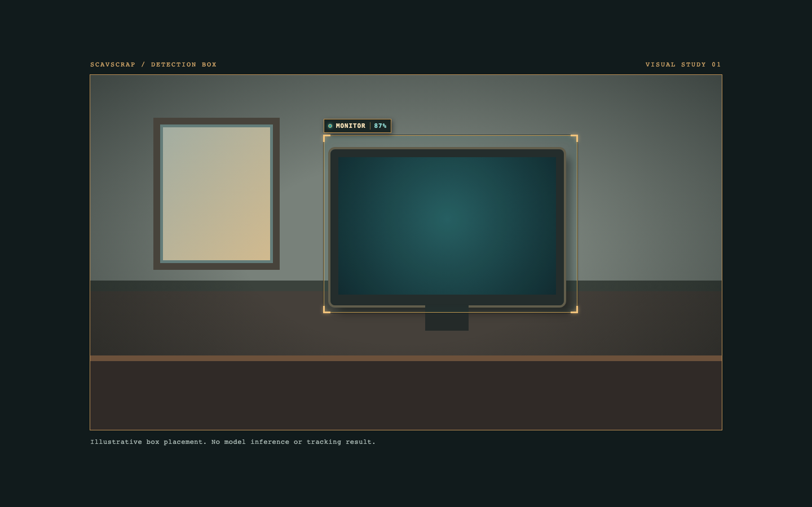
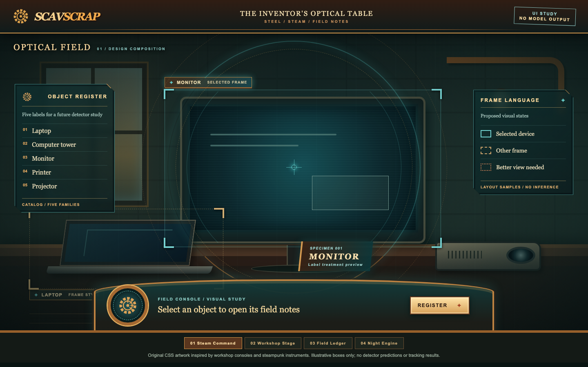

# ScavScrap


**An honest bake-off of pretrained detectors (YOLO, YOLO-World, Gemini) for five
electronics classes, with webcam and Meta-glasses live-capture prototypes.
Predictions come from pixels only; no accuracy is claimed until scored runs
exist.**

---

## Table of Contents

- [Overview](#overview)
- [Status](#status)
- [Candidates in the bake-off](#candidates-in-the-bake-off)
- [Tech Stack](#tech-stack)
- [Quickstart](#quickstart)
- [What every run guarantees](#what-every-run-guarantees)
- [Live mode and Meta glasses relay](#live-mode-and-meta-glasses-relay)
- [UI mockups](#ui-mockups)
- [Repository layout](#repository-layout)
- [Disclaimer](#disclaimer)
- [License](#license)

---

## Overview

ScavScrap is the recognition groundwork for an engineering-learning app that
identifies everyday electronics. Before any app ships, this repository answers
one question with recorded evidence: **which pretrained detector reliably finds
these five devices in real photos?**

| Class | Definition (canonical text in [`labels/classes.json`](labels/classes.json)) |
| --- | --- |
| `laptop` | Portable computer with a permanently attached hinged keyboard base |
| `phone` | Handheld mobile phone; not a tablet or landline handset |
| `headphones` | Over- or on-ear headphones with a headband; not earbuds |
| `smartwatch` | Wrist-worn watch with a digital touch display; not a clock |
| `speaker` | Standalone loudspeaker enclosure; not one built into another device |

No model is trained or fine-tuned here. Predictions come only from image pixels:
filenames, folders and ground truth never reach a model.

```text
pretrained detector evaluation
→ evidence-based model decision
→ live-capture prototypes (laptop webcam, Meta glasses relay)
→ application integration later
```

## Status

| Piece | State |
| --- | --- |
| Detection harness, scorer, tests | Done. 51 unit tests, all mocked; none is model inference |
| Live camera and Meta glasses relay | Ran end to end on real hardware (2026-10-24) |
| Five-class prompts and configs | Migrated to the class list above; **not yet run on real images** |
| Scored bake-off | **Blocked.** It needs permitted photos with reviewed ground-truth boxes |

No accuracy claim can be made until the bake-off is scored.

## Candidates in the bake-off

| Run | How it works | Classes covered |
| --- | --- | --- |
| **Gemini 3.5 Flash-Lite** (primary) | One API call per image returns labelled boxes | All five |
| **Cascade** (fallback) | Local YOLO-World proposes boxes, then one Gemini call labels them | All five; recall is capped by YOLO's proposals |
| YOLO-World S / L / X | Local open-vocabulary detector with five text prompts | All five |
| YOLO26n COCO | Local baseline | `laptop` and `phone` (from COCO `cell phone`) only |

Every run is scored with the same greedy IoU ≥ 0.5 matching. The winner is
picked by the decision rule frozen in
[`evaluation/bakeoff_report_template.md`](evaluation/bakeoff_report_template.md).

## Tech Stack

- **Detection:** Ultralytics YOLO26n (COCO) and YOLO-World v2, PyTorch, OpenCV
- **Cloud labelling:** Gemini API (`GEMINI_API_KEY` from the environment only)
- **Live capture:** iOS Swift app with the Meta Wearables Device Access Toolkit
- **Frontend:** React 18 + Vite

## Quickstart

Requires Python 3.13 and [uv](https://docs.astral.sh/uv/).

```sh
uv sync                        # Ultralytics + CLIP, pinned in uv.lock
source .venv/bin/activate
python -m unittest             # 51 tests, no network, no weights
python -m recognition.yolo_runner --help
```

Real runs need local weights and, for Gemini, `GEMINI_API_KEY` in the
environment. See [`RUNBOOK.md`](RUNBOOK.md).

## What every run guarantees

- **Local weights only.** Runners refuse a missing weights path rather than let
  Ultralytics download one, and they check the file's embedded class list
  against the frozen config before inference.
- **Honest mappings.** A raw class maps to a project class only when the config
  declares an exact match. COCO `clock` is not `smartwatch`. An unmapped class
  is recorded as `unsupported`, never as a hit.
- **Honest outputs.** Detectors produce boxes, not masks. Gemini returns no
  calibrated confidence, so its records store `null`.
- **Full provenance.** Each JSONL record keeps the raw model output, original
  class IDs and names, `xyxy` pixel boxes, weights SHA-256, runtime version,
  command, thresholds, timing and errors. Output files are written atomically.
- **Upload consent.** Gemini runs send images to Google. Only images whose
  provenance notes permit that may be used, and live mode requires
  `--allow-upload`.

## Live mode and Meta glasses relay

`python -m recognition.live_runner OUT.jsonl --weights W --allow-upload` runs
the cascade on a webcam: YOLO-World boxes each frame, a greedy IoU tracker keeps
tracks, and Gemini labels a track once and caches it. Records mark each label as
`gemini` or `track_cache`. Re-boxes and part-of-device boxes (IoU ≥ 0.6 or ≥ 80%
inside an already-matched box) are suppressed rather than tracked, and a laptop's
keyboard or screen stays attached to the laptop even when its box flickers. A
track only continues with a box of the same detector class. Boxes under 32 px on
their short side (`--min-box-side`) are recorded but never tracked or sent to Gemini.

With `--listen 0.0.0.0:8765` it instead accepts JPEG frames POSTed to `/frame`
behind a printed bearer token. `app/ios/ScavRelay` is a Developer-Mode iPhone
app that streams the Meta glasses camera through the Meta DAT SDK to that
endpoint and overlays the returned boxes; all inference stays on the laptop.
Setup is in [`app/ios/README.md`](app/ios/README.md). Neither prototype is
evaluated.

```text
Meta glasses camera
  │  (Meta DAT SDK)
  ▼
app/ios/ScavRelay ── JPEG POST /frame + bearer token ──▶ live_runner.py --listen
  ▲                                                        │
  │                                                        ├─ YOLO-World boxes per frame
  │                                                        ├─ greedy IoU tracker
  │                                                        └─ Gemini labels each new track once
  └──────────────── boxes + labels overlaid ◀──────────────┘
```

## UI mockups

`design/` holds UI mockups (a `DetectionBox` React component and steampunk theme
previews) with illustrative data, not model output.

### Detection box

<p align="center">

</p>

### Steampunk command view

<p align="center">

</p>

## Repository layout

```text
labels/         class contract (classes.json) and box-labelling guide
recognition/    runners, frozen model configs, prompts, output schemas
evaluation/     manifest template, collection rules, scorers, report templates
app/ios/        ScavRelay: Meta glasses → laptop frame relay (Developer Mode only)
frontend/       dashboard that renders live detections (placeholder device data)
design/         UI mockups with illustrative data
tests/          cross-module contract tests
```

| Document | Read it for |
| --- | --- |
| [`DESIGN.md`](DESIGN.md) | Experiment design, support table, stop conditions |
| [`RUNBOOK.md`](RUNBOOK.md) | Exact commands for every run, scoring and checks |
| [`AGENTS.md`](AGENTS.md) | Rules for anyone (human or agent) changing this repo |
| [`evaluation/COLLECTION.md`](evaluation/COLLECTION.md) | How to collect and annotate test photos |
| [`app/ios/README.md`](app/ios/README.md) | Glasses relay setup |

## Disclaimer

This is an evaluation in progress. No model has been scored yet, so no accuracy
is claimed. The live prototypes are unevaluated, and the mockups above show
illustrative data, not model output.

## License

The code in this repository is licensed under the
[GNU Affero General Public License v3.0](LICENSE), matching Ultralytics, which
the YOLO runners depend on. If you run a modified version as a network
service, AGPL-3.0 requires offering its source to that service's users.

Photos under `evaluation/images/` and `walkaround/` are not covered by the
AGPL; all rights are reserved by their owner unless a photo's provenance notes
say otherwise.

### Third-party terms

| Component | Terms |
|---|---|
| Ultralytics and its YOLO26 / YOLO-World weights | AGPL-3.0 (or an Ultralytics Enterprise License) |
| Meta Wearables Device Access Toolkit | Proprietary [Meta Wearables Developer Terms](https://wearables.developer.meta.com/terms) and [Acceptable Use Policy](https://wearables.developer.meta.com/acceptable-use-policy); pulled in as a Swift package, not vendored |
| Gemini API | Google's Gemini API terms; images sent by the Gemini and cascade runners leave the machine |
| PyTorch | BSD-3-Clause |
| OpenCV | Apache-2.0 |
| React, Vite | MIT |
